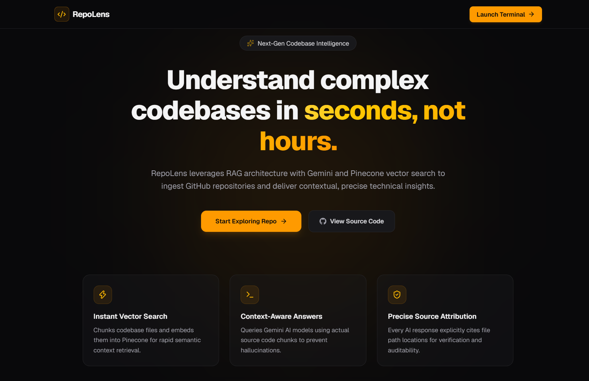
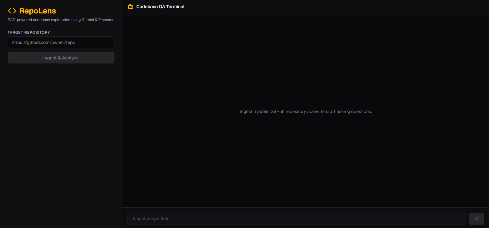

# [RepoLens 🔍](https://repolens-rag.vercel.app/)

> **RAG-powered codebase exploration tool leveraging Gemini AI and Pinecone vector search.**

RepoLens ingests public GitHub repositories, parses and chunks source files, generates embeddings, and allows users to perform context-aware semantic searches across complex codebases with precise file-path attributions.

---

## 🌟 Key Features

- ⚡ **Automated Repository Ingestion:** Fetches and processes public GitHub repositories directly from a URL.
- 🎯 **Context-Aware Code QA:** Uses Retrieval-Augmented Generation (RAG) to ground AI responses in actual repository files, eliminating hallucinations.
- 📍 **Source Attribution:** Every generated answer cites the specific files used as context.
- 🛠️ **Fully Typed Architecture:** Built with TypeScript end-to-end with strict type checks.
- 📱 **Responsive Dual-Panel UI:** Clean split-view layout for desktop and stacked interface for mobile devices using Tailwind CSS and shadcn aesthetics.

---

## 🏗️ Architecture Overview

              +-----------------------+
              |  GitHub Repository    |
              +-----------+-----------+
                          |
                          v
              +-----------------------+
              |  Ingestion Pipeline   |
              |  (File Parser/Chunker)|
              +-----------+-----------+
                          |
                          v
              +-----------------------+
              |  Vector Storage       |
              |  (Pinecone DB)        |
              +-----------+-----------+
                          |
                          v
                +-------------------+     
                | User Prompt / QA  +     
                +-------------------+
                          |
                          v
              +---+-------------------+
              | RAG Retrieval         |
              | (Gemini Embeddings)   |
              +-----------+-----------+
                          |
                          v
              +-----------+-----------+
              | Contextual Answer     |
              | & File Attributions   |
              +-----------------------+

---

## 🛠️ Tech Stack

- **Framework:** Next.js (App Router, Server Actions, API Routes)
- **Language:** TypeScript
- **AI & ML:** Google Gemini AI API (`@google/genai`)
- **Vector Database:** Pinecone (`@pinecone-database/pinecone`)
- **Styling:** Tailwind CSS, Lucide React Icons
- **Deployment:** Vercel

---

## 🚀 Getting Started

### Prerequisites

Ensure you have the following installed and set up:
- **Node.js:** v18.x or higher
- **npm / pnpm / yarn**
- **Pinecone Account:** An active index configured for vector embeddings.
- **Google Gemini API Key:** Access to Gemini API.

---

### Environment Variables

Create a `.env.local` file in the root directory and add the following keys:

```env
# Google Gemini API
GEMINI_API_KEY=your_gemini_api_key_here
# Pinecone Vector Database
PINECONE_API_KEY=your_pinecone_api_key_here
PINECONE_INDEX=your_pinecone_index_name
```

## Installation & Local Setup

### Clone the repository

```bash
    git clone https://github.com/vaidikdubey/RepoLens
    cd repolens
```

### Install dependencies

```bash
    npm install
```

### Run the app

```bash
    npm run dev
```

### Open in browser

Navigate to ```http://localhost:3000``` to access the application.

## 📂 Project Structure

```text
repolens/
├── app/
│   ├── api/
│   │   ├── chat/route.ts      # Query vector store & stream Gemini responses
│   │   └── ingest/route.ts    # Parse repo, chunk code, store embeddings
│   ├── chat/page.tsx          # Dual-panel QA Terminal interface
│   ├── layout.tsx             # Root layout & global metadata
│   └── page.tsx               # Client landing page
├── lib/                       # Gemini & Pinecone client configurations
└── public/                    # Static assets & icons
```

---

## Screenshots

- Landing Page


- Chat Interface


---

## Author

### Vaidik Dubey

- GitHub: https://github.com/vaidikdubey
- LinkedIn: https://linkedin.com/in/vaidikdubey

## 🤝 Contributing

Contributions, issues, and feature requests are welcome! Feel free to check the issues page or submit a pull request.

---

⭐ If you found this project useful, consider giving it a star!
